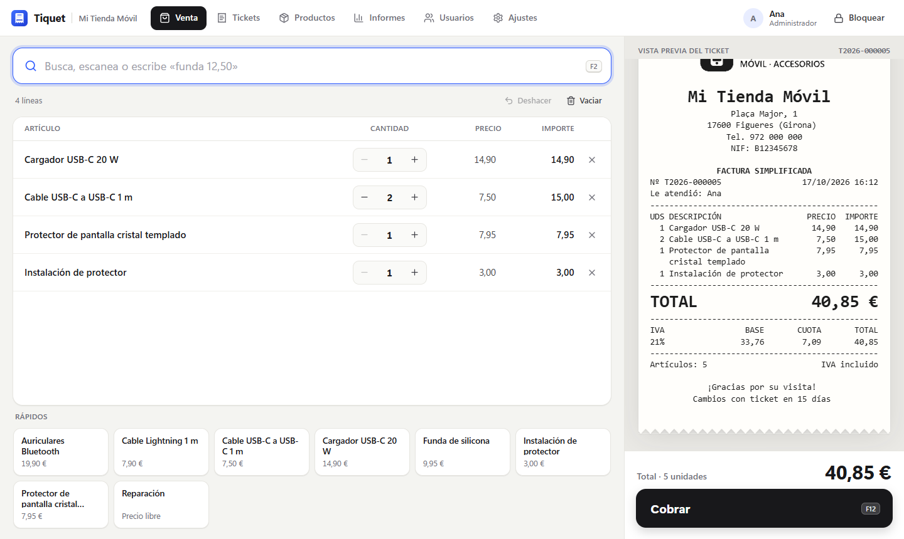
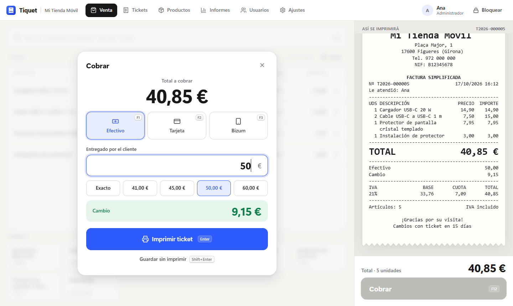
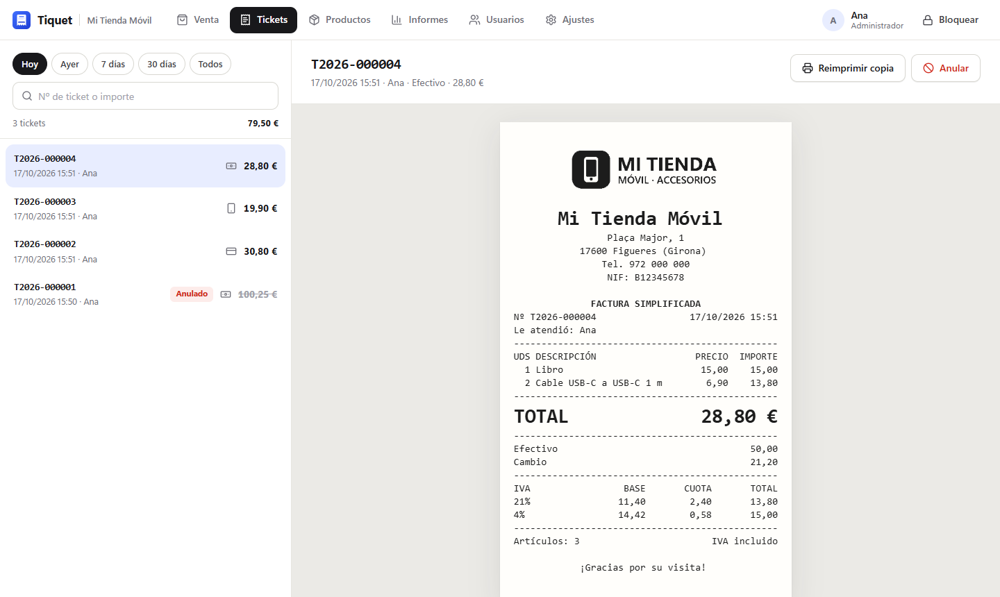
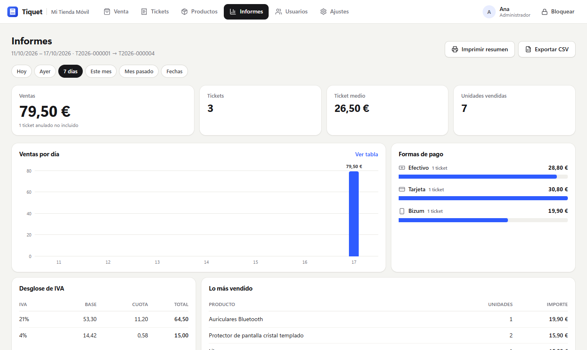
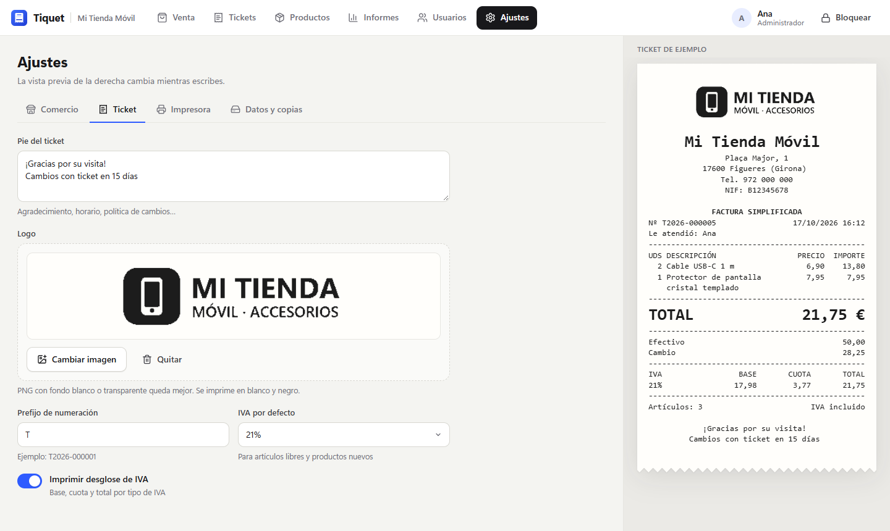

# Tiquet

[](https://github.com/Ranjitbarnala0/tiquet/actions/workflows/ci.yml)

Point-of-sale ticket printing for small shops. A Windows desktop app that prints receipts on ESC/POS thermal printers (80 mm and 58 mm), works fully offline and keeps every sale in a local database.

Built for a phone accessories shop in Spain that was printing tickets from a 1990s-style program with an advert in the footer. Tiquet prints the same kind of ticket, with the shop's own logo and none of the noise.



| Charging | Tickets |
| --- | --- |
|  |  |
| **Reports** | **Settings** |
|  |  |

## Install

Runs on Windows 10 and 11 (64-bit). No administrator rights are needed: it installs for the current Windows user.

1. Download `Tiquet_1.4.0_x64-setup.exe` from [Releases](../../releases/latest). The installer is built on a clean GitHub machine by the [release workflow](.github/workflows/release.yml), which also starts the built app once before publishing; the release lists its SHA-256.
2. Run it. The installer is not code-signed yet, so Windows SmartScreen may say "Windows protected your PC": click **More info**, then **Run anyway**.
3. On first start, enter the shop details (the NIF is checked) and create the administrator account. Write down or print the **recovery code** it shows: it is the only way back in if the administrator password is forgotten.
4. The receipt printer is picked automatically when it is clearly the only one (a POS, thermal or receipt printer, or a known brand). To choose it by hand, or to change it, use **Ajustes > Impresora** (**Detectar** looks again), then press **Imprimir página de prueba**. The interface starts in the language Windows uses.

Upgrading from 1.0, 1.1 or 1.2: run the new installer over it. From 1.3 on Tiquet updates itself: it looks for a newer release a few seconds after it starts and once a day, never while a sale is on the screen, and **Actualizar ahora** installs it silently and opens Tiquet again. **Ajustes > Datos y copias > Buscar actualización** looks by hand. Upgrading from 1.0 also moves the database: on first start it is copied to `%LOCALAPPDATA%\TiquetData`, checked, and only then is the old file renamed to `tiquet.db.moved`; a copy of the 1.0 database is also kept in `TiquetData\migraciones`.

A USB printer must be installed in Windows (with the manufacturer's driver or "Generic / Text Only"). A printer with its own network port needs no driver: choose **Impresora de red (IP)** in **Ajustes > Impresora** and type the IP address it prints on its configuration sheet (the port is 9100 on nearly all of them). If accents print as strange symbols, press **Prueba de caracteres** and choose the line that reads correctly.

## What it does

- **Selling at keyboard speed.** One search box for everything: type a name, scan a barcode, `3*cable` for three units, `funda 12,50` for an item at any price, or just `12,50`. Enter adds, F12 charges, Ctrl+Z undoes.
- **Anything, by hand.** The big **+ Artículo** button (F4), or the card in the middle of an empty ticket, adds any item with its own name, price, quantity and VAT, and can save it as a product on the way. Tapping a line changes its name, price, quantity or VAT, and can update the product's price too.
- **Products at hand.** Below the ticket: **Recientes** (what was sold lately, catalogue or not), **Favoritos** and **Todos**, one tap to add. **Repetir** puts the items of any earlier ticket into a new sale.
- **Exact preview.** The ticket on the right is rendered from the same lines that are sent to the printer, so what you see is what prints, including change and VAT.
- **Payments.** Cash with quick amounts and change, card, Bizum. Opens the cash drawer on cash sales. A barcode scanned while the payment window is open adds the item; it never confirms a payment.
- **Tickets that cannot be edited.** Numbered per year without gaps (`T2026-000001`). Issued tickets can be reprinted or voided the same day with a reason, never edited or deleted; the database enforces it.
- **Returns and invoices.** A return is its own rectifying ticket (`TR2026-...`) that points at the sale, line by line. A sale can carry the customer's name, NIF and address as a full invoice (`TF2026-...`); over 3.000 € it must.
- **Repairs.** A phone left at the shop gets its own number (`REP2026-000001`), a resguardo for the customer and a slip for the phone. Its status is kept with who changed it and when. A deposit is a ticket of its own, and **Entregar y cobrar** charges the rest in Venta. See [Repairs](#repairs).
- **Printing that tells the truth.** A ticket counts as printed once Windows has let go of it, or once a network printer has taken all of it. If the printer is off or out of paper the job is cancelled, so nothing prints and no drawer opens later on its own. The first print is the original; every other one says COPIA.
- **Cash drawer.** Opening float, cash in and out with a reason, and a closing count against what the sales say, with a printed Z report.
- **Admin.** Products (CSV import that picks the sale price and keeps barcodes), users with roles, sales reports by day or month, discounts and price changes made at the till, a printable summary, CSV export and a VAT book (libro de IVA) for the accountant. Training mode for learning: its sales never count and can be wiped.
- **Shop identity.** Logo or photo on the ticket (converted to black and white for thermal paper), trade name and owner's name, header, footer, numbering prefix.
- **Never loses a sale.** The sale is stored, with a full disk sync, before printing. The cart survives a crash or power cut and is never charged twice. A restored backup never reuses a ticket number already handed out. A database backup is taken every day and can be restored from Ajustes.
- **Runs on its own.** Updates itself, can open when Windows starts and fill the screen, and **Guardar diagnóstico** writes a zip with the log and the state of Tiquet (no database, no passwords) to send to whoever gives support.
- **VERI\*FACTU** (Real Decreto 1007/2023), off until switched on: every ticket, return and void leaves a billing record chained by its SHA-256 huella and sent to the AEAT with the owner's electronic certificate, and the ticket carries the AEAT's QR.
- **Spanish and English** interface. Tickets always print in Spanish.

## Keyboard

| Key | Action |
| --- | --- |
| Enter | Add the highlighted result; on an empty search, charge |
| F12 | Charge |
| F4 | Add an item by hand |
| F1 / F2 / F3 | Cash / card / Bizum while charging |
| Enter / Shift+Enter | Print the ticket / save without printing |
| Ctrl+Z | Undo the last change to the ticket |
| Numpad + / - | Change the quantity of the selected line |
| Delete | Remove the selected line |
| F2 | Focus the search box |

## Repairs

**Reparaciones** in the top bar lists the phones in the shop, with filters by status and a search by number, name, phone or IMEI. Cashiers and administrators use it alike; only an administrator can cancel a repair.

1. **Nueva reparación**: the customer's name and phone, the device (make, model, colour), the IMEI or serial number, the fault as the customer tells it, the estimate if there is one, and the deposit if one is paid. The resguardo on the right is what will print. Internal notes stay in the shop and never print.
2. **Guardar e imprimir** prints the deposit ticket, which opens the drawer when paid in cash. Then it prints the resguardo for the customer and the slip that goes with the phone.
3. As the work goes on, set the status: Recibido, En curso, Listo or No reparado. Every change is kept with who made it and when.
4. When the customer comes back, **Entregar y cobrar** asks for the final price and takes off the deposit. The rest goes to Venta as a line "Reparación REP2026-000001: device". Issuing that ticket marks the repair as delivered, and the ticket line keeps the repair it belongs to. With nothing left to pay, the phone is handed back straight away.

Rules:

- Repairs are numbered per year without gaps, like tickets, and a restored backup never hands out a repair number already printed.
- Repairs are never deleted. One taken in by mistake is cancelled with a reason. A deposit must be voided or returned from Tickets first.
- A delivered or cancelled repair cannot change. The one way back is voiding the ticket that delivered it, which returns the repair to its last status.
- A repair is a service, so a ticket with a repair on it is a simplified invoice only up to 400 € (RD 1619/2012 art. 4). Above that, Venta asks for the customer's details. A deposit can be 400 € at most.
- In training mode repairs can be taken in, but no deposit or delivery is charged.
- The conditions printed on the resguardo are in **Ajustes > Ticket**.

## Where the data lives

- Database and activity log: `%LOCALAPPDATA%\TiquetData` (`tiquet.db`, SQLite, and `tiquet.log`). Uninstalling Tiquet never deletes it.
- Backups: `Documents\Tiquet\Copias de seguridad`, one per day, last 60 kept. The folder can be changed in Ajustes, for example to a USB drive.
- Exports: `Documents\Tiquet\Exportaciones`.
- Diagnostics: `Documents\Tiquet\diagnostico-<date>.zip`.

To restore a backup, use **Ajustes > Datos y copias > Restaurar una copia**. The current data is copied aside first. If the database ever fails to open, Tiquet shows the backups it can restore on its start screen.

## Build from source

Requirements: Windows 10/11, [Rust](https://rustup.rs) (stable, MSVC), Node.js 20 or newer, Visual Studio Build Tools with the C++ workload.

```
npm install
npm run tauri build
```

The installer is written to `src-tauri/target/release/bundle/nsis/`. Releases are built by the [release workflow](.github/workflows/release.yml), which also signs the installer for the updater with the key in the repository secrets and publishes `latest.json`, the file installed copies read. A local build that should be able to update installed copies needs the same key in `TAURI_SIGNING_PRIVATE_KEY` and `TAURI_SIGNING_PRIVATE_KEY_PASSWORD` and `--config '{"bundle":{"createUpdaterArtifacts":true}}'`.

For UI work without the desktop shell, run the core over HTTP and open the Vite dev server in a browser:

```
npm run devserver      # Rust command layer on http://127.0.0.1:1430
npm run dev            # UI on http://localhost:1420, proxies /api to the devserver
```

Tests: `cargo test` in `src-tauri` (add `-- --ignored` to also push a job through the Windows print spooler).

Checking an installed copy without showing a window: `tiquet.exe --selftest <file>` boots the UI and a throwaway database and writes a report to `<file>`; `--check <file>` does the same with the real data. With `TIQUET_UPDATE_URL` pointing at another `latest.json`, `--selftest` first installs the update that file offers; the new version starts again with the same arguments and writes the report.

## How it is built

- **Tauri 2** shell, **Rust** core, **React** UI, **SQLite** storage. It runs on the WebView2 runtime that ships with Windows 11; on an older Windows 10 the installer fetches it.
- The UI never computes money. Totals, VAT and the ticket layout come from the core, which renders the ticket once into fixed-width lines; the same lines feed the on-screen preview and the ESC/POS encoder.
- Printing goes straight to the Windows spooler as a raw job (`RAW` for classic drivers, `XPS_PASS` for v4 drivers), or for a network printer over a TCP connection to its raw port, with code page selection, Chinese-mode cancel for generic printers, logo raster, cut and drawer pulse.
- Updates come from this repository's releases through the Tauri updater: `latest.json` names the version and carries the installer's signature, which installed copies check against the public key built into them.
- Passwords are hashed with Argon2id. Five wrong attempts lock that user, for 30 seconds and then twice as long each time up to 15 minutes, and the lock survives a restart. Administrator passwords need 6 characters. The till locks itself after a configurable idle time. Roles are checked in the core, not only in the UI.
- Every push runs the core tests, the type check and clippy on Windows ([CI](.github/workflows/ci.yml)).

## VERI\*FACTU

Tiquet works as a VERI\*FACTU system only (Real Decreto 1007/2023, Orden HAC/1177/2024): the records go to the AEAT as they are made, so there is no signature or event log to keep on the PC. It is off by default. To switch it on, use **Ajustes > VERI\*FACTU**:

1. Choose **Pruebas AEAT** (the AEAT's test environment).
2. Pick the shop owner's electronic certificate, installed in Windows for the user that runs Tiquet.
3. Sell a ticket and check that the ticket screen says it is registered.
4. Switch to **Real**.

The owner's name and NIF must be in **Ajustes > Comercio** as Hacienda has them.

Design, decisions, the AEAT documents it follows and what is still open: [docs/verifactu.md](docs/verifactu.md).
